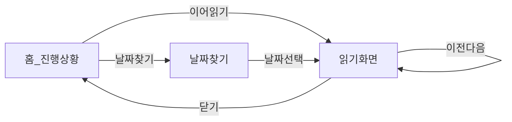

# 02. 정보 구조 · 화면 흐름

## 화면 목록

| ID | 이름 | 역할 |
|---|---|---|
| A | 홈 / 진행 상황 | 진행률 확인, 이어 읽기 진입 |
| B | 날짜 찾기 | 구약·신약·주차별 일정 탐색 |
| C | 성경 읽기 | 해당 날짜의 범위·본문·상태 변경 |

복잡한 메뉴는 두지 않습니다. 상단 탭으로 **홈 ↔ 날짜 찾기**만 전환하고, 읽기는 오버레이/전용 화면으로 진입합니다.

## 화면 흐름



추가 경로:

- 홈의 「날짜 찾기 →」 → 날짜 찾기 탭
- 날짜 찾기에서 홈 탭 → 홈

## 날짜 찾기 계층

```text
날짜 찾기
├── 필터: 전체 | 구약 | 신약 | 미완료만
├── 구약
│   ├── 1주차 → day 카드들 (CSV 실제 날짜만)
│   ├── …
│   └── 31주차
└── 신약
    ├── 1주차
    ├── …
    └── 11주차
```

규칙:

- 주차·날짜는 **CSV의 `testament` + `week_no`** 를 그대로 사용합니다.
- 특정 주차에 데이터가 없으면 가짜 날짜를 넣지 않고 빈 상태를 표시합니다.
- 「미완료만」필터 시 `completed`가 아닌 날짜만 보여 주되, 주차 완료 카운트는 해당 주차 전체 기준으로 표시하는 것이 프로토타입과 일치합니다.

## 읽기 화면 진입점

1. 홈 → 이어 읽기
2. 날짜 찾기 → 날짜 카드 클릭
3. 읽기 화면 내 → 이전 / 다음 날짜

## 후속 라우팅 초안 (코드 작성 없음)

GitHub Pages를 고려한 경로 초안입니다. 구현 시 해시 라우팅 또는 Pages fallback 중 하나를 선택합니다.

| 경로 | 화면 |
|---|---|
| `/` 또는 `/#/` | 홈 |
| `/find` 또는 `/#/find` | 날짜 찾기 |
| `/read/:day` 또는 `/#/read/:day` | 읽기 (`day` = 1~246) |

권장: Pages 새로고침 이슈를 피하려면 **해시 라우팅**을 기본안으로 둡니다. (최종 결정은 구현 단계에서 확인)

## 네비게이션 카피 (프로토타입 기준)

| 화면 | 제목 | 부제 |
|---|---|---|
| 홈 | 오늘의 말씀, 한 걸음씩 | 읽던 곳에서 이어서 읽어보세요. |
| 날짜 찾기 | 날짜별 읽기 일정 | 구약과 신약을 주차별로 확인하세요. |

브랜드 라벨: `BIBLE READING JOURNEY`
