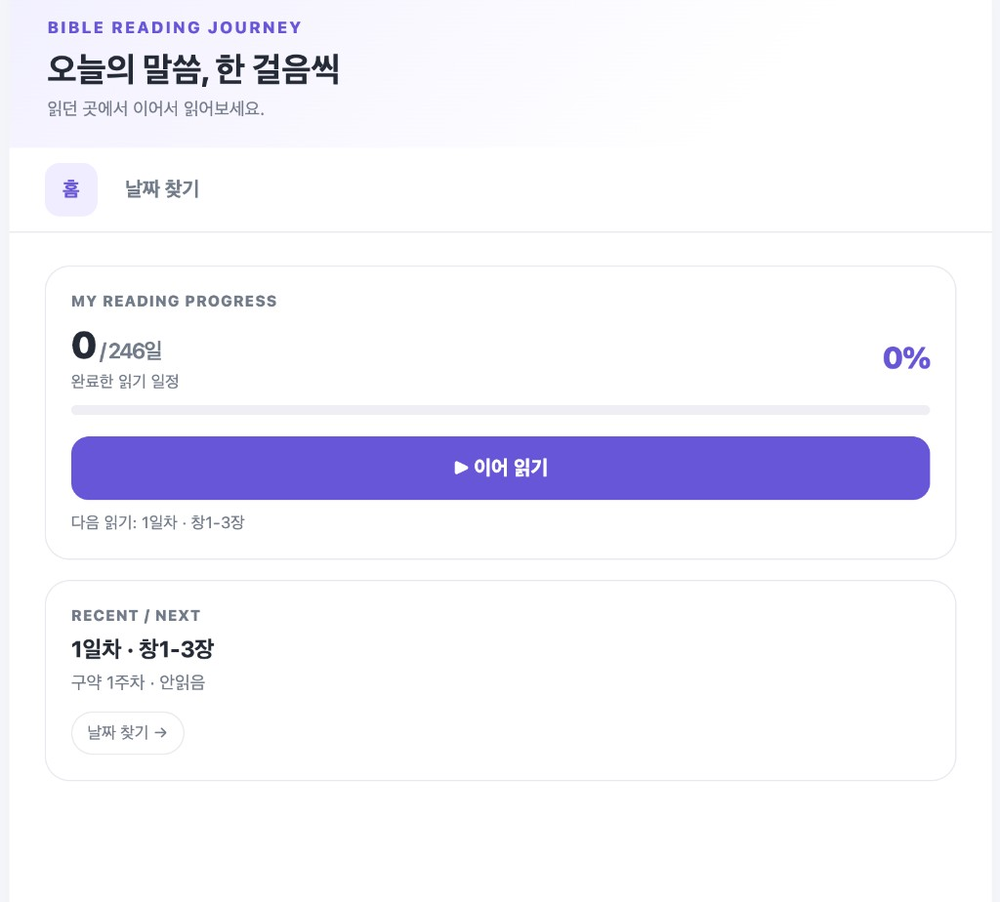
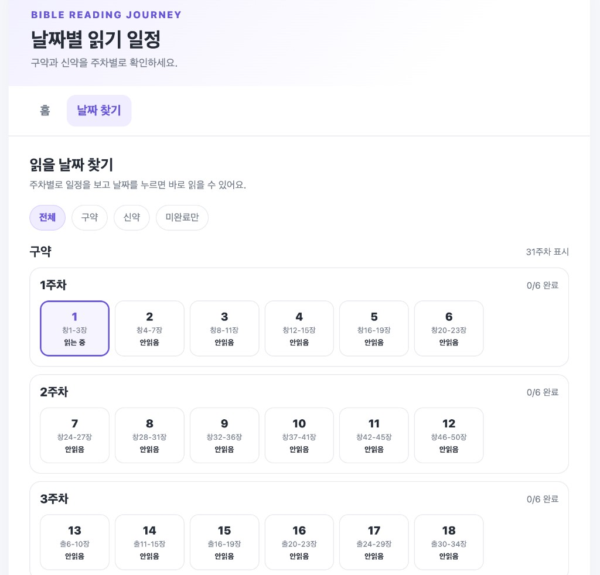
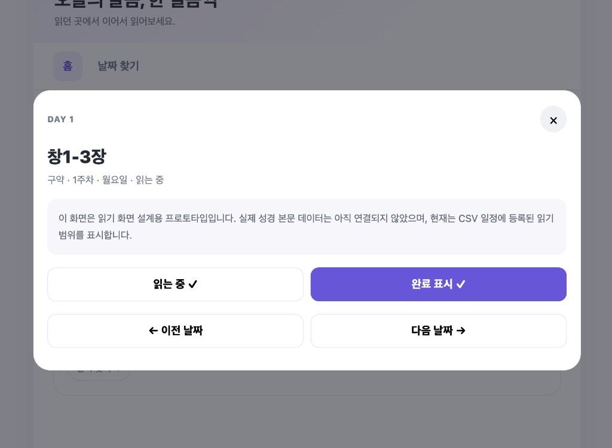

# 04. 화면 UI 스펙

시각 참고:

- HTML: [`asset/design/bible_reading_screen_design_v2.html`](../asset/design/bible_reading_screen_design_v2.html)
- 스크린샷: [`asset/design/screenshots/`](../asset/design/screenshots/)

상태 라벨은 프로토타입의 「읽는 중」대신 기획 표준 **`읽기 시작`**을 사용합니다.

---

## 디자인 토큰

HTML `:root` 기준:

| 토큰 | 값 | 용도 |
|---|---|---|
| `--ink` | `#252b36` | 본문 글자 |
| `--muted` | `#737b89` | 보조 설명 |
| `--line` | `#e7e9ef` | 테두리 |
| `--paper` | `#f7f8fb` | 페이지 배경 |
| `--purple` | `#6856d9` | 강조·CTA |
| `--pale` | `#efedff` | 활성 탭/필 배경 |
| `--green` | `#198566` | 완료 상태 |

레이아웃:

- 앱 폭 최대 약 `780px`, 중앙 정렬
- 상단 그라데이션 헤더 (`#f2f0ff` → 흰색)
- 모바일 우선, `620px` 이상에서 패딩·읽기 카드 둥근 모서리 조정

원칙:

- 심플·읽기 쉬움 우선
- 불필요한 카드·장식·애니메이션 과다 사용 금지
- **색상만으로 상태를 구분하지 않음** (텍스트·아이콘 병행)
- 키보드 포커스 가능

---

## 화면 A — 홈

### 구성

1. **헤더**
   - 브랜드: `BIBLE READING JOURNEY`
   - 제목: `오늘의 말씀, 한 걸음씩`
   - 부제: `읽던 곳에서 이어서 읽어보세요.`
2. **탭**: 홈(활성) | 날짜 찾기
3. **MY READING PROGRESS** 패널
   - `완료수 / 246일`
   - 퍼센트
   - 진행 막대
   - CTA: `▶ 이어 읽기`
   - 다음/현재 읽기 한 줄 설명
4. **RECENT / NEXT** 패널
   - 현재(또는 다음) 일차 · 범위
   - 권역 · 주차 · 상태
   - `날짜 찾기 →` pill

### 빈 상태

기록이 없으면:

- 이어 읽기 설명: 첫 일정부터 시작 안내
- RECENT: 「첫 읽기를 시작해보세요」류 카피

### 완료 전부

전 일정 완료 시 CTA 문구를 「모두 읽었어요」 등으로 바꿀 수 있음 (프로토타입 참고).

---

## 화면 B — 날짜 찾기

### 구성

1. 헤더 제목: `날짜별 읽기 일정`
2. 탭: 홈 | 날짜 찾기(활성)
3. 섹션 제목: `읽을 날짜 찾기`
4. **필터 pill**: 전체 / 구약 / 신약 / 미완료만
5. **권역 그룹** (`구약`, `신약`)
   - 우측 메타: `N주차 표시`
6. **주차 블록**
   - `N주차` + `완료수/전체수 완료`
   - day 그리드 (프로토타입: 최대 7열)
7. **날짜 카드**
   - 큰 숫자(일차)
   - 범위 약어(`abbr`)
   - 상태 텍스트: `안읽음` / `읽기 시작` / `완료`

### 카드 상태 스타일 (프로토타입 매핑)

| 상태 | 클래스 느낌 | 표기 |
|---|---|---|
| `unread` | 기본 테두리 | 안읽음 |
| `in_progress` | purple 테두리·연보라 배경 | 읽기 시작 |
| `completed` | 연녹 배경·초록 숫자 | ✓ 완료 |

클릭 영역은 손가락으로 누르기 쉽게 충분한 높이(`min-height` ~67~75px).

---

## 화면 C — 읽기

프로토타입은 하단(모바일) / 중앙(데스크톱) 오버레이 카드입니다.

### 구성

1. `DAY {n}` 키커 + 닫기(×)
2. 큰 제목: `reading_range`
3. 메타: `{구약|신약} · {week}주차 · {weekday}요일 · {상태}`
4. **본문 영역**
   - 연결 전: 연한 안내 박스 (범위만 표시, 본문 미연결 안내)
   - 연결 후: 절 단위 본문, 읽기 편한 글자 크기·줄간격
5. 액션 1행: `읽기 시작` / `완료 표시`
6. 액션 2행: `← 이전 날짜` / `다음 날짜 →`

### 버튼 동작 (기획)

| 버튼 | 동작 |
|---|---|
| 읽기 시작 | 상태를 `in_progress`로 (이미면 표시만) |
| 완료 표시 | 상태를 `completed`로 |
| (완료 해제 — 구현 시) | `unread`로 되돌림 |
| 이전/다음 | day ± 1, 범위 밖이면 비활성 |
| 닫기 | 오버레이 닫고 홈(또는 직전 탭) |

본문 스크롤 자동 완료는 **실제 본문 렌더링 시에만** 적용합니다.

---

## 반응형

- 모바일: 단일 컬럼, 날짜 그리드 열 수 축소 가능
- 태블릿/데스크톱: 패딩 확대, 읽기 카드 중앙 모달

## 접근성 체크 (구현 시)

- [ ] 탭·필터·날짜·닫기가 키보드로 조작 가능
- [ ] 상태 텍스트가 스크린리더/시각적으로 모두 확인 가능
- [ ] 포커스 링이 사라지지 않음
- [ ] 대비가 충분한지 확인
