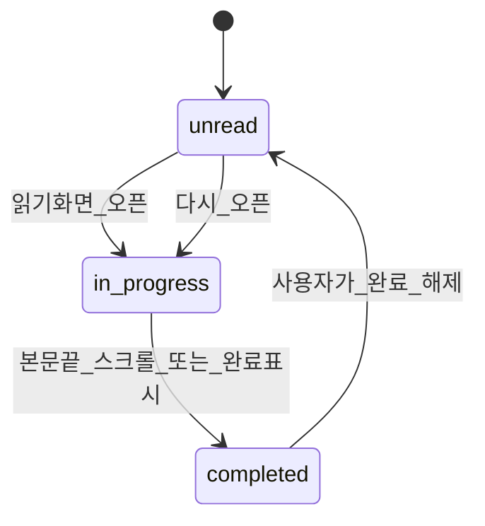

# 05. 읽기 상태 · localStorage

## 저장 위치

- 브라우저 **`localStorage`만** 사용합니다.
- 서버·계정·클라우드 동기화 없음.
- 같은 브라우저 + 같은 origin에서만 유지됩니다. 다른 기기/브라우저와 공유되지 않습니다.

## 키

```text
bibleReadingProgress:v2:{scheduleId}
```

예: `bibleReadingProgress:v2:chrono-246`, `bibleReadingProgress:v2:yearly-365`

스케줄마다 진행도를 **분리**합니다. 일정을 바꿔도 다른 스케줄의 완료 기록은 덮어쓰지 않습니다.

### 마이그레이션

- 구키 `bibleReadingProgress:v1`이 있고 `chrono-246`의 v2 키가 비어 있으면 → v1 내용을 `chrono-246`으로 한 번 복사합니다.

## 정식 스키마 (채택)

개발 가이드의 권장 구조를 **정식 규격**으로 사용합니다.

```json
{
  "version": 1,
  "progress": {
    "1": {
      "status": "completed",
      "updatedAt": "2026-01-01T00:00:00.000Z"
    },
    "2": {
      "status": "in_progress",
      "updatedAt": "2026-01-01T00:00:00.000Z"
    }
  },
  "lastReadDay": 2
}
```

| 필드 | 설명 |
|---|---|
| `version` | 스키마 버전 숫자 |
| `progress` | 키 = 일정 번호 문자열 (`"1"` … `"N"`, N = 활성 스케줄 dayCount) |
| `progress[n].status` | `unread` \| `in_progress` \| `completed` |
| `progress[n].updatedAt` | ISO 8601, 저장 시점 생성 (문서 예시 시각 고정 금지) |
| `lastReadDay` | 마지막으로 연 읽기 화면의 `reading_day` |

### 저장하지 않는 것

- `reading_range`, 주차, 권역 등 일정 정보 → 스케줄 JSON에서 조회
- 본문 텍스트

활성 스케줄 ID는 설정 키 `bibleReadingSettings:v1`의 `scheduleId`에 저장합니다.

## 프로토타입과의 차이

[`bible_reading_screen_design_v2.html`](../asset/design/bible_reading_screen_design_v2.html)은 단순 형태입니다.

```json
{ "1": "completed", "2": "in_progress" }
```

이는 UI 실험용입니다. **앱 구현은 위 정식 스키마**를 따릅니다.  
필요하면 구형 단순 맵을 읽었을 때 정식 스키마로 한 번 변환하는 마이그레이션을 둡니다.

## 화면 표기

| 코드 | 한글 |
|---|---|
| `unread` (또는 키 없음) | 안읽음 |
| `in_progress` | 읽기 시작 |
| `completed` | 완료 |

키가 없거나 알 수 없는 값이면 **`unread`로 취급**하고 앱이 죽지 않게 합니다.

## 상태 전이



추가 규칙:

1. `completed` 날짜를 다시 열어도 자동으로 `in_progress`로 바꾸지 않음.
2. 본문이 **없을 때** 스크롤 자동 완료를 하지 않음.
3. 완료 수동 해제 시 `in_progress`가 아니라 **`unread`**.
4. 읽기 화면을 열 때마다 `lastReadDay` 갱신.
5. 홈 진행률 = `status === completed` 인 개수 ÷ 활성 스케줄 일수.

## 이어 읽기 정책

1. `lastReadDay`가 유효하면 그 날짜로 이동.
2. 없거나 무효하면 **1일차**.
3. `lastReadDay`가 완료여도 **다음 날로 자동 점프하지 않음**.

(프로토타입 HTML의 “첫 미완료 찾기” 로직과는 다릅니다. **가이드/본 기획이 우선**입니다.)

## 오류·복구

| 상황 | 대응 |
|---|---|
| 키 없음 | 빈 progress + lastReadDay 없음으로 시작 |
| JSON 파싱 실패 | 기본값으로 복구 |
| 알 수 없는 status | 해당 day를 unread로 간주 |
| day가 1…N 밖 | 무시 |
| localStorage 사용 불가 | 메모리 상태로 동작 + 저장 실패 안내 (흰 화면 금지) |

## 동기화 범위 (문서화용)

- 저장 범위: 해당 브라우저의 해당 사이트 주소
- 미지원: 다중 기기 동기화, 계정 백업, 서버 복구

사용자에게 「이 기기 브라우저에만 저장됩니다」를 README/설정 안내에 명시합니다.
